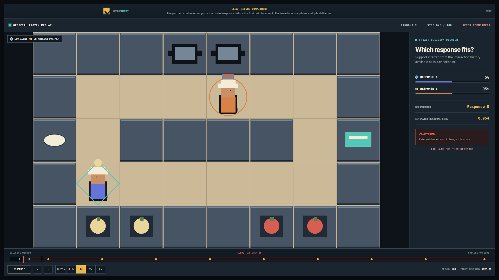
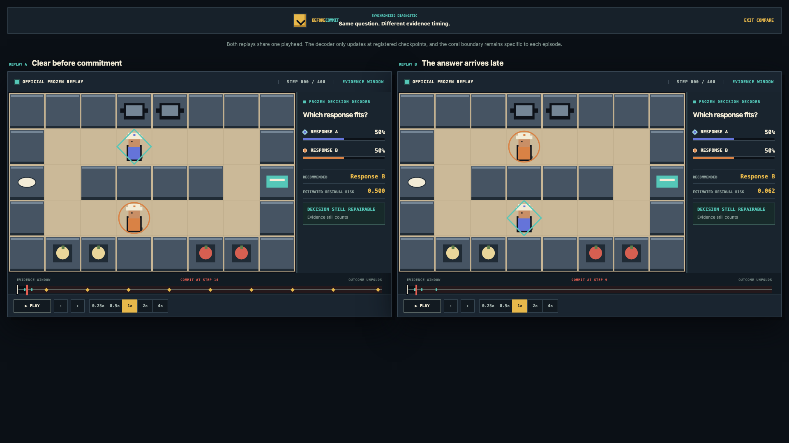

# BeforeCommit

[](https://github.com/fawzmehfil/zsc-identifiability/actions/workflows/pages.yml)
[](https://fawzmehfil.github.io/zsc-identifiability/)


[](LICENSE)

**A replay-first benchmark for evaluating teammate adaptation before commitment.**

An agent coordinating with an unfamiliar teammate must do more than act competently. It must
infer which response fits the teammate before an important joint decision becomes costly to
reverse. BeforeCommit makes that question inspectable frame by frame using frozen official
ZSC-Eval policies, commitment-timed diagnostics, and deterministic replay artifacts.

<p align="center">
  
</p>

<p align="center">
  <a href="https://fawzmehfil.github.io/zsc-identifiability/">Live replay viewer</a> · <a href="docs/assets/beforecommit-full-replay-2x.mp4">Complete 2× replay</a> · <a href="phase-6-established-validation/results/README.md">Frozen results</a> · <a href="paper/README.md">Paper builds</a> · <a href="demo/README.md">Replay contract</a>
</p>

## Overview

Existing zero-shot coordination evaluations can show that different partners require different
best responses. That does not establish that an evaluated agent can determine which response is
appropriate from the interaction history available before commitment.

BeforeCommit visualizes this missing property, called **decision-sufficient partner
identifiability**. Its metric, decision-relevant identifiability (DRI), measures the fraction of
prior response-selection risk removed by evidence available before a named commitment time.

The evaluation chain is:

```text
observe partner -> update response evidence -> commit -> coordinate -> measure response loss
```

The viewer keeps three quantities separate:

- **Replay evidence:** what one recorded interaction reveals at each diagnostic checkpoint.
- **Decision-relevant identifiability:** how much response-selection risk is removed across the
  frozen partner-history distribution before commitment.
- **Task outcome:** the sparse return produced by the recorded episode.

This separation matters because a team can succeed despite ambiguous evidence, or identify the
right response and still fail for another reason.

<table>
  <tr>
    <td width="50%" align="center"></td>
    <td width="50%" align="center"></td>
  </tr>
  <tr>
    <td align="center"><sub>Replay evidence, commitment, and decision risk</sub></td>
    <td align="center"><sub>Synchronized early-versus-late evidence comparison</sub></td>
  </tr>
</table>

## Watch a complete replay

This is the featured frozen ZSC-Eval episode from beginning to end at 2× speed. The browser
replays committed state and diagnostic artifacts. It does not retrain either agent or simulate a
new outcome.

<p align="center">
  <a href="docs/assets/beforecommit-full-replay-2x.mp4"></a>
</p>

<p align="center">
  <a href="docs/assets/beforecommit-full-replay-2x.mp4">Watch the full-quality MP4</a> · <a href="https://fawzmehfil.github.io/zsc-identifiability/#replays">Open the replay collection</a>
</p>

## What BeforeCommit measures

Each public replay contains:

- Two frozen agents in an Overcooked-style cooperative task.
- A held-out partner mode that is not exposed to the evaluated ego agent as a label.
- Exact visual state, actions, rewards, interactions, and delivery events.
- Frozen decoder support for the candidate coordination responses at registered checkpoints.
- An empirical response-library loss for the recorded partner mode.
- A commitment boundary at the first successful pot placement.
- Aggregate precommitment DRI kept separate from the confidence trace of one episode.

The six curated replays cover clear early evidence, evidence that arrives too late, informative
failure, success under partial identifiability, ordinary task progress, and a temporary role
intervention. They explain distinct cases and are not estimates of how frequently each behavior
occurs.

## Official audit result

The frozen official-checkpoint audit evaluated 50 partners from six published method families in
two layouts and both physical seats. The fresh confirmation design contained 9,600 episodes.

| Scope | Value |
|---|---:|
| Official partners | 50 |
| Method families | 6 |
| Layouts | 2 |
| Seats per layout | 2 |
| Fresh confirmation episodes | 9,600 |

Adding precommitment DRI to the registered controls produced a modest held-out predictive gain
for normalized response-library regret.

| Primary GRU result | Overall | `random3_m` | `small_corridor` |
|---|---:|---:|---:|
| ΔR² | **+0.02047** | +0.02426 | +0.007449 |
| ΔMAE | -0.003394 | -0.002199 | -0.001228 |
| ΔMSE | -0.001369 | -0.000896 | -0.000598 |

The adjusted DRI coefficient for regret was `-0.18035`, with a clustered 95% interval of
`[-0.29499, -0.07918]`. Higher precommitment identifiability predicted lower regret after the
registered controls. Neither tested natural intervention reliably increased decision-relevant
information.

That is the result: DRI provides complementary measurement value, but the observed effect is
modest and does not establish a causal effect, a new probing algorithm, or systematic failure of
existing zero-shot coordination methods.

Full publication-facing tables, figures, correction procedures, and source hashes live in
[`phase-6-established-validation/results`](phase-6-established-validation/results/README.md).

## Quick start

Open the [hosted replay viewer](https://fawzmehfil.github.io/zsc-identifiability/) to explore the
curated runs without installing anything.

### Run the visual benchmark

The deployable replay data is committed, so the viewer requires no checkpoint runtime or backend:

```bash
git clone https://github.com/fawzmehfil/zsc-identifiability.git
cd zsc-identifiability
npm --prefix web install
npm --prefix web run dev
```

Open [http://localhost:5173](http://localhost:5173).

Production checks are:

```bash
npm --prefix web test
npm --prefix web run lint
npm --prefix web run build
```

### Render the complete video

Build and serve the production viewer in one terminal:

```bash
npm --prefix web run build
npm --prefix web run preview -- --host 127.0.0.1
```

Then render the deterministic 1080p replay from another terminal:

```bash
npm --prefix web run capture:video
```

The capture runs headlessly, advances every committed replay frame, selects 2× playback, and
writes `docs/assets/beforecommit-full-replay-2x.mp4`.

### Reproduce the replay export

Replay capture requires the locally synchronized official checkpoints and pinned ZSC-Eval
runtime. It performs CPU inference only and rejects a rerun if its return, seat, episode length,
visible actions, or commitment step differs from the archived confirmation trace.

```bash
uv sync --dev

uv run zsc-identifiability demo capture \
  --curation demo/curation/official-v1.yaml \
  --output demo/artifacts/replays

uv run zsc-identifiability demo export-site \
  --replays demo/artifacts/replays \
  --output web/public/static-api

uv run zsc-identifiability demo validate \
  --site-data web/public/static-api
```

The [replay artifact contract](demo/README.md) documents the schema, metric separation,
provenance, and upstream licenses.

## Replay viewer

The viewer plays recorded official-checkpoint episodes. Every frame comes from a versioned static
artifact, and the browser never loads raw checkpoints or model observation tensors.

It supports exact seeking, event markers, commitment timing, frozen response diagnostics,
presentation mode, artifact provenance, and synchronized comparison.

Useful routes after starting the viewer:

- `/`: benchmark overview and curated replay library.
- `/replays/{replay_id}`: full replay, interpretation, and provenance.
- `/compare?left=...&right=...`: synchronized two-replay comparison.
- `/present/{replay_id}`: clean presentation mode.
- `/static-api/catalog.json`: read-only replay catalog.

## Technical shape

| Layer | Implementation |
|---|---|
| Frozen inference | Pinned Python 3.9 ZSC-Eval runtime, CPU only |
| Research package | Python 3.12, NumPy, Pandas, PyTorch, SciPy, Pydantic |
| Replay exporter | Deterministic JSON, schema validation, SHA-256 integrity |
| Decision diagnostic | Cross-fitted event decoders and empirical response-library losses |
| Viewer | React, TypeScript, Phaser, original procedural pixel art |
| Typography | IBM Plex Mono and Press Start 2P, matching the Voyager presentation system |
| Delivery | Static artifacts and GitHub Pages, no backend |
| Verification | Pytest, Vitest, mypy, Ruff, TypeScript checks, replay parity gates |

The browser package contains normalized world state, actions, rewards, and events. It excludes the
model's 1,000-dimensional observation tensors, raw checkpoints, and machine-specific asset paths.

## Research package

BeforeCommit is an interface to a completed decision-sufficient identifiability study. The main
research layers are:

| Component | What it establishes |
|---|---|
| [Exact finite games](phase-2-exact-model/README.md) | Bayes risk, DRI, overlap identities, regret bounds, and intervention thresholds |
| [Matched benchmark](phase-3-matched-benchmarks/README.md) | DRI varies while competence, response diversity, predictability, and identity information are controlled |
| [Learned-agent audit](phase-4-learned-audit/README.md) | Evidence acquisition, memory, and decision use are separated against exact oracles |
| [Official validation](phase-6-established-validation/README.md) | DRI adds held-out predictive value across two official ZSC-Eval layouts |

DRI is normalized Bayes-risk reduction, not new information theory. It credits exact partner
identity only when that identity changes the best coordination response.

Manuscript sources and reproducible LaTeX targets are documented in [`paper/`](paper/README.md).

## Limitations

The official audit covers two Overcooked layouts, dyadic teams, fixed partner modes, one selected
commitment definition, and an approximate response library. The predictive effect is modest and
observational. The benchmark does not establish scaling to larger teams, human-like
understanding, reliable active probing, or a causal effect of DRI on regret.

The visual collection is deliberately curated. It is designed to make benchmark behavior
inspectable, not to replace the complete statistical audit.

## License

BeforeCommit is released under the [MIT License](LICENSE). Official ZSC-Eval source and checkpoint
provenance are documented in the
[asset and license card](phase-6-established-validation/official-assets-and-license-card.md).
