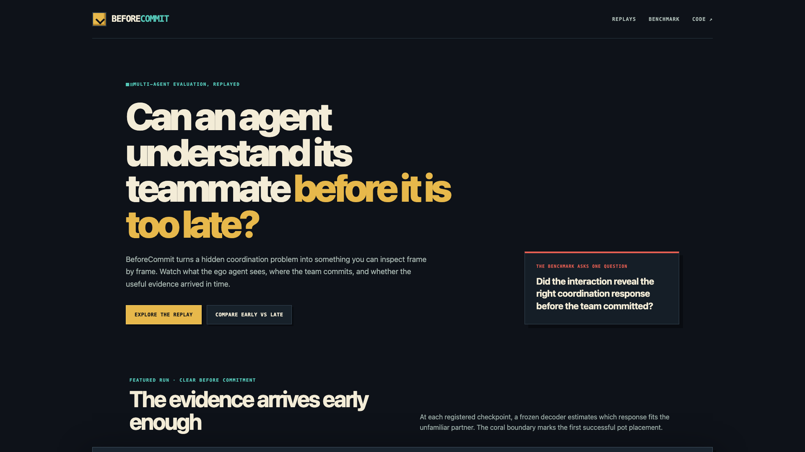

# BeforeCommit

**A visual benchmark for testing whether an agent gets enough useful evidence
to coordinate with an unfamiliar teammate before an important decision.**

[Live demo](https://fawzmehfil.github.io/zsc-identifiability/) ·
[Replay library](https://fawzmehfil.github.io/zsc-identifiability/#replays) ·
[Readable report](paper/reader-report/) ·
[Frozen results](phase-6-established-validation/results/README.md) ·
[MIT license](LICENSE)



[Watch the 25-second launch preview](docs/assets/beforecommit-launch.mp4)

BeforeCommit turns the completed decision-sufficient identifiability research
into a replay-first evaluation tool. Two frozen agents enter a cooperative
cooking task. The evaluated agent does not receive its unfamiliar partner's
mode as a label. The viewer can inspect what evidence appeared, when the team
first committed to a response, and how much response-selection risk remained.

## What the viewer shows

- A top-down, frame-exact replay from an official ZSC-Eval checkpoint.
- The ego agent, unfamiliar partner, held items, interactions, deliveries, and
  first successful pot placement.
- Frozen decoder support for the two partner modes at registered checkpoints.
- The response recommended under the empirical response-library loss matrix.
- A permanent commitment boundary separating useful early evidence from
  evidence that arrived too late for the focal decision.
- Aggregate decision-relevant identifiability (DRI), kept separate from the
  confidence trace for any one replay.

The public collection contains six curated stories: clear early evidence, late
evidence, informative failure, success under partial identifiability, and a
matched ordinary-progress versus natural-intervention comparison.

## Frozen benchmark scope

The underlying official-checkpoint audit used:

| Scope | Value |
|---|---:|
| Official partners | 50 |
| Published method families | 6 |
| Layouts | 2 |
| Physical seats per layout | 2 |
| Fresh confirmation episodes | 9,600 |

Adding precommitment DRI to the registered controls produced a modest held-out
predictive gain for normalized response-library regret, `Delta R² = 0.020`.
The adjusted DRI coefficient was `-0.180`, with a clustered 95% interval of
`[-0.295, -0.079]`. Neither tested natural intervention reliably increased
decision-relevant information. The final claim is measurement validity, not a
new probing algorithm.

## Run the visual benchmark

The deployable replay data is committed, so the viewer requires no model
runtime or backend:

```bash
git clone https://github.com/fawzmehfil/zsc-identifiability.git
cd zsc-identifiability/web
npm install
npm run dev
```

Open `http://localhost:5173`. Production checks are:

```bash
npm test
npm run lint
npm run build
```

## Reproduce the replay export

Capture requires the locally synchronized official checkpoints and pinned
ZSC-Eval runtime. It performs CPU inference only and rejects a rerun if its
return, seat, episode length, visible actions, or commitment step differ from
the archived confirmation trace.

```bash
uv sync --dev

uv run zsc-identifiability demo capture \
  --curation demo/curation/official-v1.yaml \
  --output demo/artifacts/replays

uv run zsc-identifiability demo export-site \
  --replays demo/artifacts/replays \
  --output web/public/static-api

uv run zsc-identifiability demo validate \
  --site-data web/public/static-api
```

See [the replay artifact contract](demo/README.md) for the versioned schema,
metric separation, provenance, and license details.

## Technical architecture

| Layer | Implementation |
|---|---|
| Frozen inference | Pinned Python 3.9 ZSC-Eval runtime, CPU only |
| Replay exporter | Python, Pydantic, deterministic JSON, SHA-256 integrity |
| Decision diagnostic | Frozen cross-fitted event decoders and empirical response losses |
| Viewer | React, TypeScript, Phaser, procedural pixel art |
| Delivery | Static JSON and GitHub Pages, no backend |
| Verification | Python tests, Vitest, TypeScript checks, replay parity gates |

The browser artifacts contain normalized world state, actions, rewards, and
events. They do not contain the model's 1,000-dimensional observation tensors,
raw checkpoints, or machine-specific asset paths.

## Research methodology

The visual benchmark is an interface to the completed research rather than a
new scientific result. The full package includes:

| Component | What it establishes |
|---|---|
| [Exact finite games](phase-2-exact-model/README.md) | Bayes risk, DRI, overlap identities, regret bounds, and intervention thresholds |
| [Matched benchmark](phase-3-matched-benchmarks/README.md) | DRI varies while competence, response diversity, predictability, and identity information are controlled |
| [Learned-agent audit](phase-4-learned-audit/README.md) | Evidence acquisition, memory, and decision use are separated against exact oracles |
| [Official validation](phase-6-established-validation/README.md) | DRI adds held-out predictive value across two ZSC-Eval layouts |

DRI is normalized Bayes-risk reduction, not new information theory. It asks
whether response-relevant evidence was available before a task-defined
commitment time. Exact partner identity is unnecessary when multiple partners
require the same response.

## Limitations

The official audit covers two Overcooked layouts, dyadic teams, fixed partner
modes, one selected commitment definition, and an approximate response
library. The predictive effect is modest and observational. The interface does
not imply that DRI measures human-like understanding, that every held-out
scheme improves, or that the tested interventions create active probing.

The upstream environment and checkpoint licenses and pinned revisions are
documented in [the official asset card](phase-6-established-validation/official-assets-and-license-card.md).
